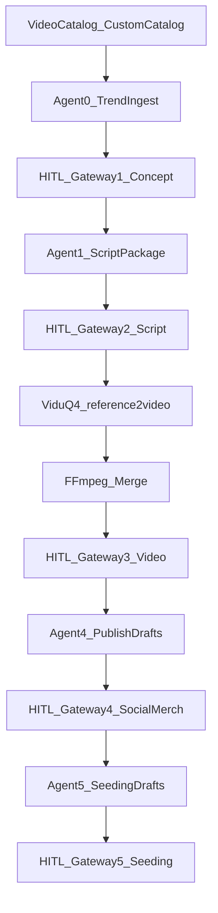
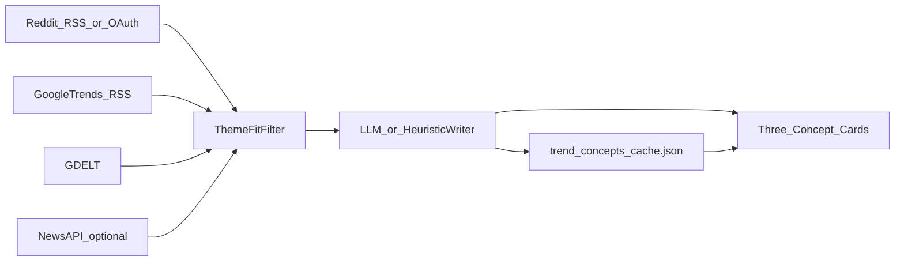

# CRASH OUT — Architecture (POC)

## High-level flow

## Key modules

| Path | Role |
|---|---|
| `run.py` | Entry — starts Uvicorn |
| `app/main.py` | FastAPI app, REST `/api/*`, Vidu render + merge |
| `app/ui.py` | HITL Hub routes (HTMX partials) |
| `app/state.py` | Episode state machine; index + per-episode JSON |
| `app/paths.py` | `outputs/ep_<id>_<Title>/`, public URL helpers |
| `app/config.py` | Vidu + Agent 0 credentials from `.env` |
| `app/personas.py` | Character bible + HOA script package |
| `app/catalog.py` | Built-in + custom catalog videos/concepts |
| `app/engines/vidu_engine.py` | Vidu Q4 client |
| `app/video_merger.py` | FFmpeg concat → `merged_60s.mp4` |
| `app/agents/agent_m_orchestrator.py` | Gateway approve + QA helpers + logs |
| `app/agents/agent_0_trend_ingest.py` | Gate 1 concepts (thin wrapper) |
| `app/trends/` | Live trend collect → filter → concept writer → cache |
| `app/agents/agent_1_scriptwriter.py` | Script package by `script_key` |
| `app/agents/agent_4_publisher.py` | Social/merch draft package |
| `app/agents/agent_5_seeder.py` | Community seeding drafts |
| `app/templates/` | Jinja HITL stages |
| `characters/` | Shared `*_9x16.png` refs (outside `outputs/`) |
| `outputs/` | Episode folders + `pipeline_index.json` + trend cache |

## Episode storage

- Folder: `outputs/ep_<episode_id>_<Sanitized Title>/`
- Files: `episode.json`, `.episode_id`, `scene_1..4.mp4`, `merged_60s.mp4`, optional merch mockup
- Index: `outputs/pipeline_index.json` (active episode + lightweight listing)
- Empty / no-progress episodes are pruned; mid-pipeline episodes with script or `gateway >= 2` are kept even without MP4s

## Agent 0 live ingest

Fallback order: **live cards → quality cache → static HOA/Stanley concepts**.

## Env (see `.env.example`)

- **Required for video:** `VIDU_API_KEY`, Vidu model/base URL
- **Optional for Agent 0:** `REDDIT_*`, `NEWS_API_KEY`, `OPENAI_API_KEY` / `OPENAI_MODEL`
