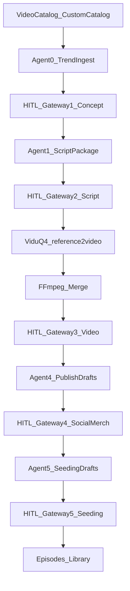

# CRASH OUT — Architecture (POC)

## High-level flow



## Package layout

```
Crash_Out/
├── run.py                 # Uvicorn entry
├── requirements.txt
├── .env.example
├── assets/                # Optional intro/outro bumpers only
├── characters/            # Shared 9:16 refs + library.json
├── docs/                  # Product / architecture / JD reference
│   └── reference/prompts/ # Original scene prompt text refs
├── outputs/               # Episode media + index (gitignored)
└── app/
    ├── main.py            # FastAPI app + /api/* render/merge
    ├── ui.py              # HITL Hub (Jinja + HTMX routes)
    ├── config.py
    ├── paths.py
    ├── state.py
    ├── catalog.py
    ├── personas.py
    ├── prompts.py
    ├── agents/            # Agent adapters
    ├── engines/           # Vidu + local preview engines
    ├── trends/            # Agent 0 web-search ingest
    ├── studio/            # Studio domain helpers
    │   ├── generation.py  # Queue, credits, finals library
    │   ├── characters.py
    │   ├── prompt_library.py
    │   ├── audio.py
    │   ├── export.py
    │   ├── qa.py
    │   └── worker.py
    ├── media/
    │   └── merger.py      # FFmpeg scene concat
    ├── templates/
    └── static/            # CSS/JS + brand art
```

## Key modules

| Path | Role |
|---|---|
| `run.py` | Entry — starts Uvicorn |
| `app/main.py` | FastAPI app, REST `/api/*`, Vidu render + merge |
| `app/ui.py` | HITL Hub routes (HTMX partials) |
| `app/state.py` | Episode state; index + per-episode JSON |
| `app/paths.py` | `outputs/`, `characters/`, `assets/` helpers |
| `app/config.py` | Env / Vidu settings |
| `app/catalog.py` | Built-in + custom catalog |
| `app/engines/` | Vidu Q4 + local preview factory |
| `app/studio/` | Queue, characters, export, QA, worker |
| `app/media/merger.py` | FFmpeg → `merged_60s.mp4` |
| `app/agents/` | Orchestrator + Agent 0/1/4/5 |
| `app/trends/` | Agent 0 Layer A/B/C ingest, clustering, friction scoring, Top-5 pitches |

## Pages

| Route | Role |
|---|---|
| `/` | Production dashboard |
| `/studio` | In-progress HITL pipeline (create / work shows here) |
| `/episodes` | **Finished** library only (cleared all gateways) |
| `/characters` | Character library |

## Episode storage

- Folder: `outputs/ep_<episode_id>_<Sanitized Title>/`
- Files: `episode.json`, `.episode_id`, `scene_1..4.mp4`, `merged_60s.mp4`, optional merch mockup
- Index: `outputs/pipeline_index.json`
- Brand art: `app/static/assets/brand/`

## Video engines

- `VIDEO_ENGINE=mock` (default) → local FFmpeg placeholders
- `VIDEO_ENGINE=vidu` → live Q4 API
- Factory: `app/engines/factory.py`

## Env (see `.env.example`)

- **`VIDEO_ENGINE`:** `mock` or `vidu`
- **Live video:** `VIDU_API_KEY`, model/base URL
- **Optional Agent 0:** `OPENAI_API_KEY`
- Optional bumpers: `assets/intro.mp4`, `assets/outro.mp4`
